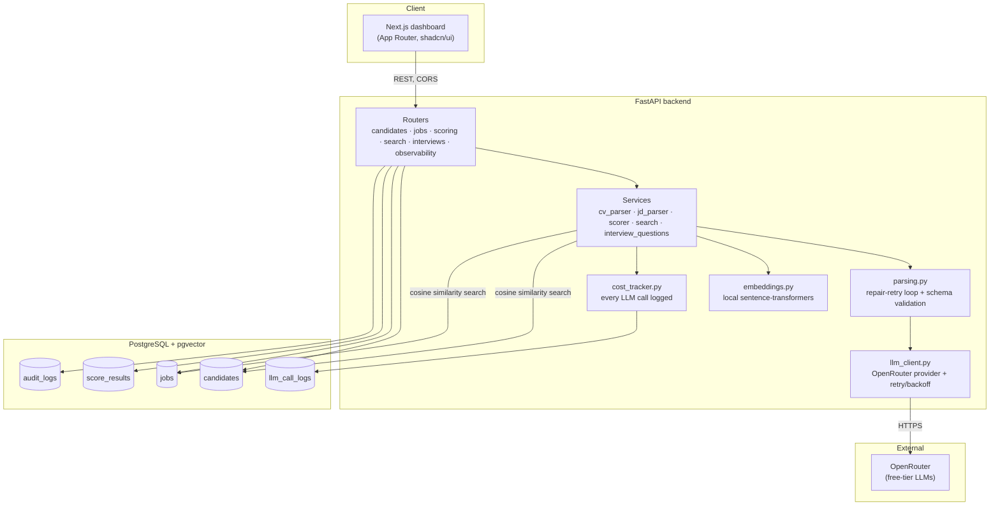

# Architecture

## System overview

## Request flow: uploading a CV

1. `POST /candidates` or `/candidates/upload` (frontend paste-text form or file upload).
2. Router extracts text (`file_extraction.py` for PDF/txt/md) and calls `cv_parser.parse_cv`.
3. `parse_cv` → `parsing.parse_structured`: sends a system prompt + the raw text to the LLM
   provider, validates the JSON response against the `CandidateParsed` Pydantic schema. On
   invalid JSON or a schema violation, the validation error is fed back to the model and
   retried (up to 3 attempts) — free-tier models are meaningfully less reliable at strict JSON
   than GPT-4/Claude, so this is a deliberate, budgeted-for reliability layer, not a patch.
4. On success: candidate row stored with `parsed` (JSONB) and `embedding` (pgvector, from the
   local `sentence-transformers` model — zero per-call cost).
5. Every LLM call (success or failure, including each repair attempt) is logged via
   `cost_tracker.record_llm_call`: tokens, latency, attempt count, success/failure.
6. An `audit_logs` row records the parse event.

## RAG search + re-rank

Two-stage design (`services/search.py`):

1. **Retrieval**: pgvector cosine-distance search narrows the full candidate/job pool to
   `RETRIEVAL_K` (20) nearest neighbors. This is the actual "R" in RAG — it's what makes search
   scale past a full-table LLM scan.
2. **Re-rank**: within that pool, results are re-ordered using a heuristic combining vector
   similarity (50%), required-skill overlap (30%), and minimum experience fit (20%). Raw embedding
   similarity alone can't tell a candidate who merely *reads* similar to a JD from one who
   actually has the required skills — the heuristic corrects for that.

A cross-encoder model is the standard production upgrade for stage 2. It's intentionally not
built here: it's an extra model dependency and inference cost with no labeled relevance data yet
to prove it beats the heuristic. Documented as a known simplification, not a hidden gap.

## Why a repair-retry loop instead of a bigger/paid model

The project deliberately runs on OpenRouter's free-tier models to keep this a $0-cost portfolio
piece. That means occasional malformed JSON and occasional upstream rate-limiting (429s from the
model provider, not this app). Both are handled explicitly:

- **Malformed/invalid JSON** → `parsing.py` repair loop (up to 3 attempts, error fed back to the
  model).
- **Upstream rate-limiting (429/5xx)** → `llm_client.py` transport-level retry with backoff,
  honoring `Retry-After`. After 3 attempts it raises `LLMProviderUnavailableError`, which routers
  turn into a `503` — an honest "try again," not a crash.

## Testing strategy

- **Unit tests** (parsers, scorer, search math, LLM client retry logic): run fully offline against
  `MockLLMProvider` / `FakeHashEmbedding` — no network, no Postgres.
- **API tests**: run against a real Postgres + pgvector instance (`recruitment_copilot_test`, a
  database dedicated to tests — never the dev/demo database, so running `pytest` can't wipe seed
  data).
- **Eval harness** (`backend/eval/`): the one place that intentionally hits the *real* LLM. 12
  hand-labeled candidate/job pairs scored against an expected fit tier. Run manually, not in CI —
  it's a sanity check against obviously-wrong scoring, not a statistically significant benchmark
  (12 cases is too small to claim more than that).
