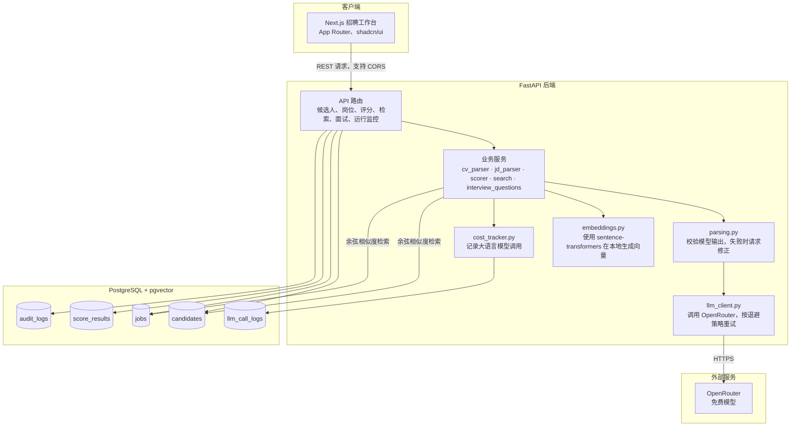

# 系统架构说明

## 系统概览

## 一份简历如何入库

1. 用户粘贴简历文本时，前端调用 `POST /candidates`。上传文件时，前端调用 `POST /candidates/upload`。
2. 对于 PDF、TXT 和 Markdown 文件，后端先通过 `file_extraction.py` 提取文本。两种提交方式都由 `cv_parser.parse_cv` 解析简历正文。
3. `parse_cv` 调用 `parsing.parse_structured`，将系统提示词和简历原文发送给大语言模型，再用 Pydantic 模型 `CandidateParsed` 校验返回的 JSON。如果 JSON 无法解析，或字段不符合约束，解析器会把错误信息发回模型，请它修正。含首次调用在内，最多尝试 3 次。
4. 解析成功后，后端将结构化结果写入候选人记录的 `parsed` 字段（JSONB），并将本地模型生成的向量写入 `embedding` 字段（pgvector）。
5. 每次模型调用都会通过 `cost_tracker.record_llm_call` 记录 token 用量、耗时、尝试次数和成功状态，修正输出时的调用也计入其中。
6. 后端将本次解析事件写入 `audit_logs`，便于追溯。

## 语义检索与重排

`services/search.py` 分两步为岗位查找候选人，或为候选人查找岗位。

1. **向量召回。** pgvector 按余弦距离从全部记录中取出最接近的 20 条（`RETRIEVAL_K`）。后续排序只需处理这批结果，无需让模型逐条读取整张表。
2. **匹配度重排。** 综合分由向量相似度（50%）、必备技能覆盖度（30%）和最低工作年限匹配度（20%）组成。即使两份简历与岗位描述的措辞相近，满足更多必备技能的候选人也能在这一轮获得更高的技能分。

另一种重排方式是使用交叉编码器，对每组候选人和岗位联合打分。这会增加模型依赖和推理耗时。目前缺少用于比较检索排序效果的人工相关性标注，因此项目沿用加权规则。

## 模型输出修正与请求重试

项目使用 OpenRouter 免费模型控制演示费用。后端分别处理两类常见故障：

- **响应格式错误。** 如果模型返回的 JSON 无法解析或不符合字段约束，`parsing.py` 会把具体错误反馈给模型，最多尝试 3 次。
- **上游服务暂时不可用。** 遇到限流或特定服务端错误时，`llm_client.py` 会延长重试间隔，并遵循上游返回的 `Retry-After`。连续 3 次尝试失败后，客户端抛出 `LLMProviderUnavailableError`，路由返回 HTTP `503`，提示调用方稍后重试。

## 测试与评估

- **单元测试**覆盖解析、评分、排序计算和模型客户端的重试逻辑。测试使用 `MockLLMProvider` 和 `FakeHashEmbedding`，可以离线运行，无需连接 PostgreSQL。
- **API 测试**使用装有 pgvector 的 PostgreSQL 实例。专用数据库 `recruitment_copilot_test` 将测试数据与开发、演示数据隔离。
- **模型评估**位于 `backend/eval/`，需手动运行，会调用真实模型。评估将 12 组人工标注的候选人和岗位配对与预期匹配等级比较，用于发现明显的评分偏差。样本规模不足以估计整体准确率，因此这项评估单独运行，不纳入 CI。
